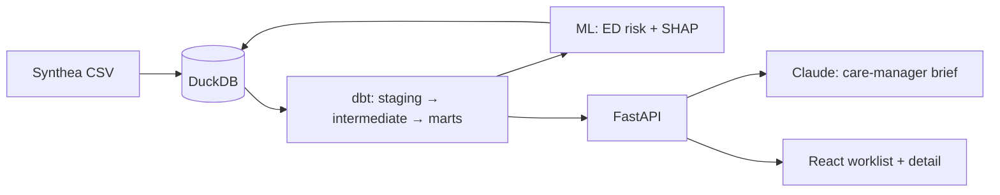

# Care Gap Radar

> **Synthetic data only — not real patients.** All patients come from [Synthea](https://github.com/synthetichealth/synthea). The code still handles them as if they were PHI.

A small, local population-health app for a fictional FQHC in value-based care. It answers one question for a care manager:
**"Which of my patients should I call this week, and what should I say?"**

## Architecture



_Placeholder: refined in the polish phase._

## How to run

Prerequisites: [uv](https://docs.astral.sh/uv/), Java 17+, Node LTS.

```bash
cp .env.example .env      # add ANTHROPIC_API_KEY
make setup                # Python + web dependencies
make all                  # data → dbt → train → score
make api                  # http://localhost:8000
make web                  # http://localhost:5173
make test
```

Run `make help` to list all targets.

## Design decisions

_TBD._

## What I'd do in production

_TBD._
