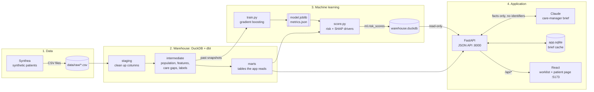
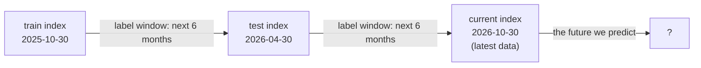
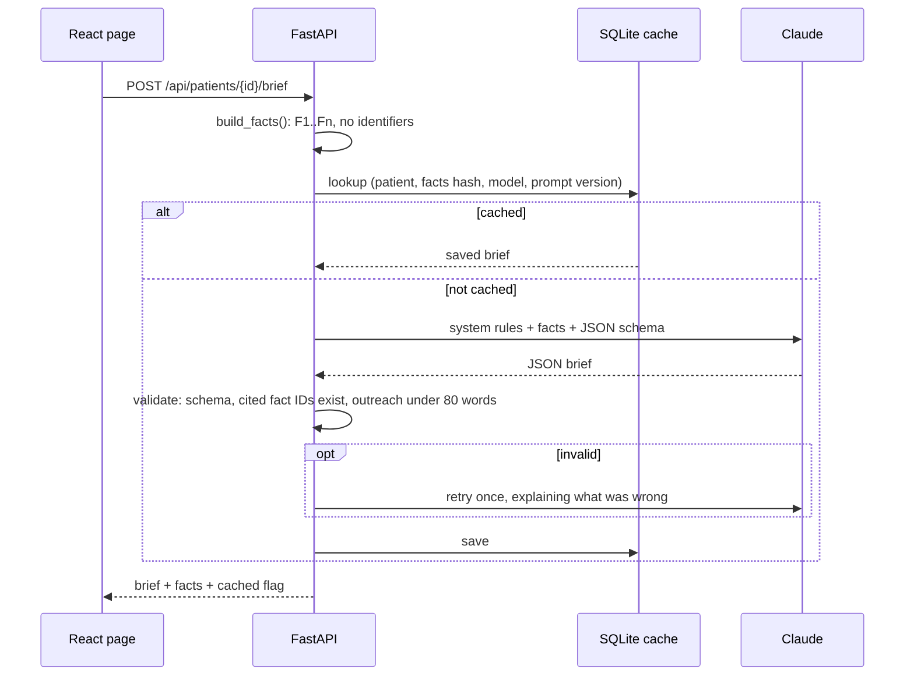

# Care Gap Radar

> **Synthetic data only — not real patients.** Every patient here was generated by [Synthea](https://github.com/synthetichealth/synthea). The code still treats the data as if it were real protected health information (PHI), because that is the habit this project is meant to demonstrate.

Care Gap Radar is a small, local, end-to-end population-health app for a fictional community health center. It answers one question for a **care manager** (a nurse or social worker who helps patients between doctor visits):

> **"Which of my patients should I call this week, and what should I say?"**

It does that in three steps:

1. **Find patients with care gaps:** overdue tests or uncontrolled conditions.
2. **Rank patients by predicted risk** of an emergency department (ED) visit in the next 6 months.
3. **Draft a short brief** for each patient with an AI model (Claude), using only verified facts, including a plain-language message the care manager can adapt.

This was built as a weekend learning project. Most of the tools here were new to me, so this README explains every piece from scratch: what it is, why it is here, and where to find it in the code. Nothing assumes you already know the topic.

---

## Contents

1. [Quick start](#1-quick-start)
2. [The big picture](#2-the-big-picture)
3. [Healthcare background in plain English](#3-healthcare-background-in-plain-english)
4. [The technologies, one by one](#4-the-technologies-one-by-one)
5. [How it works, step by step](#5-how-it-works-step-by-step)
6. [Results (honestly)](#6-results-honestly)
7. [Design decisions](#7-design-decisions)
8. [Surprises found in the data](#8-surprises-found-in-the-data)
9. [Testing](#9-testing)
10. [Project layout](#10-project-layout)
11. [What I'd do in production](#11-what-id-do-in-production)
12. [Glossary](#12-glossary)

---

## 1. Quick start

### Prerequisites

| Tool | Why it's needed | Check with |
|---|---|---|
| [uv](https://docs.astral.sh/uv/) | Installs Python 3.11 and all Python packages | `uv --version` |
| Java 17+ | Runs Synthea, the synthetic patient generator; only needed to regenerate data | `java -version` |
| Node.js (LTS) | Runs the web frontend | `node --version` |
| An Anthropic API key | Only for generating real AI briefs; everything else works without it | — |

The whole project runs on a 2019 Intel MacBook Pro with 16 GB of RAM. It needs no GPU and no Docker.

### Run it

```bash
cp .env.example .env      # then put your key after ANTHROPIC_API_KEY=
make setup                # install Python and web dependencies
make all                  # data → dbt → train → score   (about 30 seconds if data exists)
make test                 # 24 tests, no API calls, no cost
```

Then use **two terminals**:

```bash
make api                  # terminal 1: backend on http://localhost:8000  (API docs at /docs)
make web                  # terminal 2: frontend on http://localhost:5173  ← open this
```

### Things worth knowing

- **Stop the API before running `make dbt` or `make score`.** DuckDB lets only one program write to the database file at a time, and the API holds it open.
- **`make data` doesn't overwrite existing data.** Synthea simulates patients up to "now", so regenerating produces a *different* population and every number in this README would change. Use `make data FORCE=1` if you really want new data. A fresh run takes about 2 minutes and about 1.5 GB of disk.
- **AI briefs are cached.** Generating one costs a fraction of a cent: about 1,400 input tokens and 900 output tokens with Claude Haiku. Clicking "Generate" again for the same patient reads from the cache for free. "Regenerate" forces a new paid call.
- **`make help`** lists every target. **`make clean`** removes derived files (database, model, build output) but keeps the raw data and the brief cache.

---

## 2. The big picture



**Follow one patient through the system:**

1. **Synthea** invents a 71-year-old woman with diabetes, hypertension and obesity, including 30+ years of doctor visits, lab results and prescriptions. It writes them as rows in CSV files.
2. **dbt** turns those rows into one tidy record per patient. It works out her age, insurance and visit counts, and whether she has a **care gap**. She does: her last blood pressure was 142/104, above the 140 limit.
3. **The ML model** reads her record and predicts she is in the **99th percentile** for ED-visit risk. **SHAP** explains why: a recent inpatient stay, 13 outpatient visits, and a visit 6 days ago.
4. **FastAPI** serves all of this as JSON. When the care manager clicks "Generate care brief", the API turns her record into about 11 de-identified facts such as *"Age 70–79, female, Medicare"* and sends only those to **Claude**. Her name, ID and dates never leave.
5. **Claude** returns a structured brief: a summary, the reasons for the risk, 1–3 actions (each citing the facts that support it), and a short message to the patient. The API checks the brief, caches it, and returns it.
6. **React** shows her near the top of the worklist. On her page, hovering a citation chip like `F6` highlights the exact fact the AI used.

---

## 3. Healthcare background in plain English

| Term | What it means here |
|---|---|
| **FQHC** (Federally Qualified Health Center) | A community clinic, funded partly by the federal government, that serves everyone regardless of ability to pay. Many of its patients are on Medicaid or uninsured. |
| **Value-based care** | A payment model where clinics are rewarded for keeping patients *healthy* (fewer ER trips, better-controlled conditions), not just for the number of visits. That gives the clinic a reason to reach out to patients *before* they get sick. |
| **Care manager** | The person who acts on this app's output: calls patients, books appointments, removes obstacles such as transport and cost. |
| **Care gap** | Something recommended for a patient that hasn't happened. Example: a person with diabetes should have an HbA1c blood test regularly; if there's none in the past 12 months, that's a gap. |
| **HbA1c (A1c)** | A blood test showing average blood sugar over about 3 months. The standard way to monitor diabetes. |
| **Blood pressure (BP), systolic** | The top number in "142/94". 140 or more is the classic "uncontrolled hypertension" cutoff used here. |
| **ED visit** | A visit to the Emergency Department (the ER). Expensive and often avoidable with good outpatient care, which makes it a common target in value-based care. |
| **Payer** | Who pays for care. **Medicaid** (low-income, state + federal), **Medicare** (65+ or disabled, federal), **private** insurance, or none. "Dual eligible" people have both Medicare and Medicaid; we group them under Medicare because Medicare pays first. |
| **PHI** (Protected Health Information) | Health data linked to a person: name, address, dates, record numbers. US law (HIPAA) restricts how it's used and shared. |
| **Minimum necessary** | A HIPAA principle: share only the data a task needs. Here the AI gets age *bands* and *relative* dates, never names or exact dates. |
| **Medical codes** | Standard IDs so computers agree on meaning. **SNOMED CT** codes diagnoses (`44054006` = type 2 diabetes). **LOINC** codes lab tests (`4548-4` = HbA1c, `8480-6` = systolic BP). **RxNorm** codes medications. |

---

## 4. The technologies, one by one

Each entry covers **what it is**, **why it's here**, and **where to look**.

### Synthea — fake but realistic patients
- **What:** an open-source simulator (Java) that "lives out" thousands of synthetic lives: births, illnesses, doctor visits, lab results, prescriptions, insurance changes, deaths. It's built on published disease statistics, so the data *behaves* like real records without being anyone's.
- **Why:** real health data is legally hard to get and share. Synthea data can be put on GitHub or shown in an interview.
- **Where:** `synthea/run.sh` generates about 2,000 patients in Chicago with a fixed random seed (`-s 42`) and copies the CSVs to `data/raw/`.

### DuckDB — the database
- **What:** a database that lives in a single file (`data/warehouse.duckdb`), like SQLite, but built for **analytics**: scanning and summarizing millions of rows quickly. It can also query CSV files directly.
- **Why:** it stands in for a cloud data warehouse like **Snowflake**. Same SQL ideas, but free, local and instant to set up.
- **Where:** everything under `transform/` writes to it; `api/db.py` reads from it.

### dbt (data build tool) — turning raw data into clean tables
- **What:** you write each table as a SQL `SELECT` statement in its own `.sql` file. dbt figures out the order to build them in (from the `{{ ref('other_model') }}` references), creates the tables, and runs **tests** on the data. Think of it as "a Makefile for SQL, with tests".
- **Why:** it's the industry standard for analytics engineering. It keeps transformations versioned, reviewable and tested instead of buried in scripts.
- **Key ideas used here:**
  - **Sources** (`models/staging/_sources.yml`): tell dbt where the raw CSVs are.
  - **Layers:**
    - **staging** (`stg_*`): rename and type columns only.
    - **intermediate** (`int_*`): the business logic.
    - **marts** (`mart_*`): final tables shaped for the app.
  - **Seeds** (`seeds/*.csv`): small lookup tables kept in git, such as the list of SNOMED codes that count as "diabetes".
  - **Tests:**
    - **Generic tests** in the `.yml` files: `not_null`, `unique`, `accepted_values`.
    - **Singular tests** in `transform/tests/`: a SQL query that should return *zero rows*. Any row it returns is a failure.
- **Where:** `transform/`. Run with `make dbt`.

### uv — Python package manager
- **What:** a fast tool that installs the right Python version and the exact package versions listed in `uv.lock`.
- **Why:** anyone can recreate the identical environment with `uv sync`. It's much faster than pip.
- **Where:** `pyproject.toml` (what we need) and `uv.lock` (exactly what got installed).

### pandas and scikit-learn — the machine-learning model
- **What:** **pandas** handles tables in Python. **scikit-learn** is the standard Python ML library. We use its `GradientBoostingClassifier`.
- **Gradient boosting, in plain words:** build a small decision tree (a flowchart of yes/no questions like "more than 2 ED visits last year?"). See which patients it gets wrong. Build another small tree focused on those mistakes. Repeat 200 times and add up all the trees' votes. The result is a strong predictor made of many weak ones.
- **Why this model:** it handles mixed data (counts, yes/no flags, money) without much preparation. It captures interactions (old *and* many medications). And it can be explained exactly with SHAP. (LightGBM and XGBoost are popular faster versions, but they need an extra system library on macOS, so we kept to scikit-learn.)
- **Where:** `ml/train.py`, `ml/score.py`, `ml/features.py`.

### SHAP — explaining each prediction
- **What:** a method that splits one patient's prediction into contributions from each feature. For example: "starting from the average risk, *Inpatient stays = 1* pushed it **up** a lot, *Age* pushed it up a little, *Private insurance* pushed it **down**."
- **Why:** a care manager won't trust (and shouldn't act on) a bare number. The top three drivers appear on the patient page with ▲/▼ arrows, and they are also given to the AI as facts.
- **Where:** `ml/score.py` uses `shap.TreeExplainer`, which is exact and fast for tree models.

### Claude (Anthropic API) — writing the brief
- **What:** a large language model (LLM) called over HTTPS with the official `anthropic` Python SDK. The default model is `claude-haiku-5-5`, the fast, low-cost tier (set with `ANTHROPIC_MODEL` in `.env`).
- **Why:** turning a list of numbers into a readable plan and a friendly patient message is exactly what LLMs do well, provided they are kept on a short leash (section 5.6).
- **Key ideas:**
  - **Structured outputs:** we send a JSON Schema with the request, and the API guarantees the reply matches it. No parsing free text and hoping.
  - **Tokens:** LLM pricing is per token (about ¾ of a word). Each brief is about 1,400 tokens in and 900 out.
  - **Effort:** a setting for how much "thinking" the model does. `low` is enough here and saves cost.
- **Where:** `api/llm/`.

### FastAPI, Pydantic and Uvicorn — the backend
- **What:**
  - **FastAPI** is a Python web framework. You write ordinary functions, and it turns them into HTTP endpoints.
  - **Pydantic** defines the *shape* of data as Python classes and validates it. A response missing a field is an error, not a silent bug.
  - **Uvicorn** is the server that runs the app.
- **Why:** you get type-checked JSON and free interactive docs at **http://localhost:8000/docs**, where you can try every endpoint in the browser.
- **Where:** `api/main.py` (endpoints), `api/schemas.py` (the data shapes), `api/queries.py` (SQL).

| Method | Path | Returns |
|---|---|---|
| GET | `/api/health` | status, date the data runs to, model version |
| GET | `/api/summary` | patient and gap counts, payer mix, model metrics vs baseline |
| GET | `/api/patients?limit=&offset=&gap=&min_risk=&sort=` | the worklist: patients with open gaps first, then highest risk (`sort=risk` for risk only) |
| GET | `/api/patients/{id}` | one patient: conditions, utilization, gaps, risk drivers |
| POST | `/api/patients/{id}/brief?refresh=false` | the AI care brief (cached unless `refresh=true`) |

### SQLite — the brief cache
- **What:** the classic single-file database, built into Python.
- **Why:** caching AI responses needs a place to *write* quickly while the API runs, and DuckDB is opened read-only by the API (see the lock note above). It also keeps the budget tiny, because each brief is generated once.
- **Where:** `data/app.sqlite`, managed in `api/llm/brief.py`.

### React, TypeScript, Vite, React Router, TanStack Query — the frontend
- **React:** builds the UI from **components**, functions that return what the screen should look like for the current data (`<RiskBar percentile={97} />`).
- **TypeScript:** JavaScript with types. `web/src/api.ts` mirrors the Pydantic schemas, so a mismatched field name is caught while coding, not in front of a user.
- **Vite:** the development server and build tool. It reloads instantly on save and **proxies** `/api/*` to port 8000, so the browser sees one site.
- **React Router:** maps URLs to pages (`/` is the worklist, `/patients/:id` is the detail page). Worklist filters live in the URL too, so "Back" restores them.
- **TanStack Query:** fetches data from the API, caches it, and tracks loading and error states, so components don't hand-roll `fetch` + `useState` + `useEffect`.
- **Plain CSS** (`web/src/styles.css`), with no component library: a neutral palette and one teal accent.
- **Where:** `web/src/`.

### pytest — automated tests
- **What:** `make test` runs 24 tests in about 5 seconds, with **no network and no paid API calls**.

---

## 5. How it works, step by step

### 5.1 Index dates: how we avoid "cheating"

The ML model learns from the past to predict the future. The classic mistake is **data leakage**: accidentally letting the model see information from the period it's supposed to predict. It's like studying from the answer key: great scores in testing, useless in real life.

The fix is to take **snapshots** of the data at fixed **index dates**, and to compute every feature only from data **strictly before** that date:



| Index | Features use data before… | Label (did they visit the ED?) from… | Used for |
|---|---|---|---|
| `train` | 2025-10-30 | 2025-10-30 → 2026-04-30 | teaching the model |
| `test` | 2026-04-30 | 2026-04-30 → 2026-10-30 | grading the model on a period it never saw |
| `current` | 2026-10-30 | unknown (that's the point) | the live worklist |

Splitting by **time** (not randomly) mirrors reality: you always train on the past and predict the future. A dbt singular test (`transform/tests/assert_no_feature_leakage.sql`) fails the build if any feature uses data on or after its index date.

### 5.2 Who's in the population

A patient counts at an index date if they are **alive**, **aged 18–99**, and **had at least one visit in the prior 24 months** (`int_population.sql`). This is a simplified stand-in for **attribution**, the real-world process of deciding which clinic is responsible for which patient. The age limits are explained in [section 8](#8-surprises-found-in-the-data).

### 5.3 Features: what the model sees

All features use the 12 months before the index date unless noted (`int_patient_features.sql`):

- **Demographics:** age, sex, and payer (from the most recent visit).
- **Utilization** (how much care they used):
  - ED, inpatient, urgent-care and outpatient visit counts.
  - ED visits over 24 months.
  - Total claim cost.
  - Days since the last visit.
- **Chronic conditions:** yes/no flags for diabetes, hypertension, heart failure, COPD, asthma, kidney disease, depression and obesity. A diagnosis counts as *active* if it started before the index date and hadn't ended by it. The SNOMED codes for each condition are listed in `transform/seeds/chronic_condition_codes.csv`, found by searching the actual data.
- **Medications:** the number of distinct active medications.
- **Care gaps:** the two flags below.

The human-readable label for every feature is defined once, in `ml/features.py`, so the UI, the SHAP drivers and the AI facts always describe features the same way.

### 5.4 Care gaps

| Gap | Rule (as of the index date) | Evidence shown |
|---|---|---|
| **`DM_A1C`**: diabetes without an A1c test | Active diabetes **and** no HbA1c result (LOINC 4548-4) in the past 12 months. Prediabetes doesn't count. | "last A1c 2025-03-14" or "no A1c on record" |
| **`HTN_BP`**: hypertension not controlled | Active hypertension (SNOMED 59621000) **and** either the latest systolic BP in 12 months is ≥ 140, **or** there's no BP reading at all. | "last BP 152/94 on 2026-04-20" or "no BP in past 12 months (last 2025-06-02)" |

One subtlety: Synthea sometimes attaches diabetes *complication* codes (for example "kidney disorder due to diabetes") to patients with no other sign of diabetes. Those codes count only if the patient also has an A1c result or a diabetes medication. That's the `requires_confirmation` column in the seed.

### 5.5 The model: training, judging, explaining

**The label** is `1` if the patient had an ED visit in the 6 months after the index date, else `0`. Childbirth admissions are excluded (see [section 8](#8-surprises-found-in-the-data)). Only about **5.8%** of patients have a `1`, which makes this a *rare-event* problem.

**Training** (`make train`): gradient boosting is fitted on `train` rows and graded on `test` rows.

**Judging it fairly:** a model is only useful if it beats something simple. The **baseline** ranks patients by how many ED visits they had last year, which is what a care manager might do with a spreadsheet. Both are scored with:

- **AUROC:** pick one random patient who *did* visit the ED and one who didn't. AUROC is the chance the model ranks the ED patient higher. 0.5 is a coin flip; 1.0 is perfect.
- **PR-AUC:** how well the top of the list is filled with real ED visitors. For rare events it's more honest than AUROC. A random list scores about the base rate (0.058).
- **Top-10% capture:** of everyone who actually visited the ED, what share was in the model's top 10%? Random ordering would catch 10%.
- **Bootstrap confidence interval:** re-draw the test patients at random 2,000 times, recompute "model AUROC minus baseline AUROC" each time, and take the middle 95% of results. If that range includes 0, we **can't claim** the model is better.

**Scoring** (`make score`): every `current` patient gets a risk score, a percentile (99th means riskier than 99% of patients), and their top 3 SHAP drivers. These are written to the `ml.risk_scores` table.

### 5.6 The AI brief: keeping the LLM on a short leash



The safeguards, all in `api/llm/brief.py`:

1. **Minimum-necessary facts.** The patient record becomes a numbered list such as:
   - `F1: Age 70–79, female, Medicare`
   - `F6: Open care gap: Hypertension … Evidence: last BP 142/104 within the past month`

   It contains **no name, address, ID, exact age or exact date**. Ages become 10-year bands (90+ is grouped, as HIPAA requires), and dates become "about 3 months ago". A test enforces this for every fixture patient.
2. **Strict rules in the system prompt:**
   - Use only the facts.
   - Make no diagnoses and no medication changes.
   - Cite fact IDs for every action.
   - Write the patient message at about a 6th-grade reading level, in under 80 words.
3. **Structured outputs.** The reply must match a JSON Schema: `summary`, `risk_explanation`, `priority_actions[]`, `outreach_message`, `caveats[]`.
4. **Grounding check.** Every cited fact ID must exist; the AI can't cite "F42" if there are only 11 facts. If the check fails, the API retries once with the reason. If that fails too, it returns a clear **502** error instead of a bad brief.
5. **Caching.** Keyed by patient + a hash of the facts + model + prompt version. If the data, the model or the prompt changes, the key changes and a fresh brief is generated.
6. **Swappable provider.** `LLM_PROVIDER` chooses between:
   - `anthropic`, the real API.
   - `ollama`, a stub showing how to switch to a self-hosted model so real PHI never leaves the building. Set `OLLAMA_MODEL` and `OLLAMA_BASE_URL`.
   - `fake`, deterministic output for tests.

   The rest of the code doesn't change.
7. **Human in the loop.** The UI labels every brief as a **draft for the care manager**. Nothing is ever sent to a patient automatically.

---

## 6. Results (honestly)

Population at the current date (2026-10-30): **1,464 adults**.

| | Count |
|---|---|
| Payer mix | Private 708 · Medicare 391 · Medicaid 261 · Uninsured/other 104 |
| Open `DM_A1C` gaps | 7 |
| Open `HTN_BP` gaps | 42 (36 uncontrolled, 6 with no BP measured) |
| Patients with any open gap | 48 |

The ED-risk model, graded on the `test` snapshot (1,451 patients, 5.8% had an ED visit):

| | AUROC | PR-AUC | Top-10% capture |
|---|---|---|---|
| Gradient boosting | **0.589** | 0.099 | **23.8%** |
| Baseline: prior-year ED visits | 0.555 | **0.121** | 17.9% |

**Verdict: the model is *not clearly better* than the simple baseline.** The 95% interval for the AUROC improvement is −0.036 to +0.106, which includes zero. The UI's model card says exactly this. On this data, the model does slightly better at the top 10% but worse on PR-AUC. That's a modest, honest result. Synthea's ED visits are largely random events, so there's limited signal to find, and a demo that admits it is more credible than one claiming 0.95.

The most common top drivers are claim cost, number of medications, age, and outpatient visits: patients who already use a lot of care. Also, only **2 of the 50 highest-risk patients have an open care gap**. "High risk" and "has a gap" are mostly different lists. That's why the worklist shows patients with open gaps first by default: they have a concrete, actionable reason for a call. A "Highest risk" sort option shows the pure risk ranking.

---

## 7. Design decisions

| Decision | Why | Trade-off / alternative |
|---|---|---|
| DuckDB + dbt instead of pandas scripts | Mirrors a real Snowflake + dbt stack; SQL is reviewable and tested | Needs dbt knowledge; heavier than one script |
| Index-date snapshots + time-based split | Prevents leakage and mirrors how the model is really used | Fewer training rows than pooling many dates |
| Leakage enforced by a dbt test | A future edit that leaks fails the build instead of quietly inflating metrics | Covers only the audited date columns |
| Report the baseline with a confidence interval | A model has to beat the obvious approach to earn its place | Less impressive-looking numbers |
| Gradient boosting (scikit-learn) | Good with mixed tabular data; exact SHAP; no extra system libraries | LightGBM/XGBoost are faster but need `libomp` on macOS |
| Facts as numbered, de-identified sentences | The AI can cite them, the UI can highlight them, and tests can check for PHI | Loses some nuance compared with sending the raw record |
| Structured outputs instead of forced tool use | The API guarantees the JSON shape, and it works across current models | Validation for *meaning* (citations, word count) is still our job |
| Validate, retry once, then 502 | Bad briefs never reach the screen, and the cost is bounded (at most 2 calls) | Occasionally shows an error instead of a brief |
| Cache key includes the facts hash and prompt version | Stale briefs can't be served after the data or prompt changes | Any change means paying for new briefs |
| Read-only DuckDB per request; SQLite for the cache | No lock fights with dbt; the cache can still write | Two databases instead of one |
| Filters stored in the URL | Back button and shared links restore the exact view | Slightly more code than component state |
| Worklist sorts open gaps first, then risk | A gap gives the care manager a concrete reason to call; risk alone (a modest model) does not | The highest-risk patients without gaps appear after all 48 gap patients; one click switches to "Highest risk" |

---

## 8. Surprises found in the data

These were the most instructive moments of the project.

1. **Synthea data runs right up to the day it was generated**, and covers whole lifetimes. So "today" in this project is 2026-10-30, the date of the latest visit, not the real calendar date. It also means rerunning Synthea gives different patients (hence `make data` won't overwrite).
2. **Diabetes complication codes without diabetes.** At first, 29 of 36 "diabetes without A1c" gaps were patients whose *only* diabetes signal was a complication code attached alongside hypertension. Requiring an A1c or diabetes medication as confirmation fixed this (7 real gaps remain).
3. **Childbirth counted as an emergency.** Synthea records labor as an ED visit. Before we excluded it (reason code 72892002), **35 of the top 50 risk scores were pregnant patients**: technically correct, but useless for a care manager.
4. **Children and centenarians.** The first worklist had a 1-year-old in the 99th percentile and 18 patients aged 100–109 (0.9% of patients, vs about 0.03% in the US). Both care gaps are adult measures, so the population is now limited to ages 18–99. This also slightly improved the model.
5. **Sparse conditions.** Depression appears for only about a dozen patients, so its flag carries almost no signal.

---

## 9. Testing

| What | How | Where |
|---|---|---|
| Data quality | dbt tests: unique and not-null keys, allowed values for gap codes, payers and index names | `transform/models/**/_*.yml` |
| No leakage | Singular test: no feature dated on or after its index date | `transform/tests/assert_no_feature_leakage.sql` |
| Population rules | Singular tests: alive at index date, aged 18–99 | `transform/tests/` |
| API contracts | Status codes, response shapes, 404s, filters, sorting | `tests/test_api.py` |
| **No PHI in prompts** | No name, ID, exact age or date in what the AI receives | `tests/test_brief.py` |
| Grounding and validation | Unknown fact IDs → retry → 502; outreach of 80+ words is rejected | `tests/test_brief.py` |
| Caching | Second call is cached; `refresh` regenerates; per-patient keys | `tests/test_brief.py` |
| Fixture realism | The test database's columns match the real mart | `tests/test_contract.py` |

The tests use a 3-patient fixture database and the `fake` provider. Any attempt to create a real Anthropic client during tests fails the test, so `make test` can never spend money.

---

## 10. Project layout

```
care-gap-radar/
  Makefile                  # make setup / all / api / web / test / clean
  pyproject.toml, uv.lock   # Python dependencies (exact versions locked)
  .env.example              # copy to .env; holds ANTHROPIC_API_KEY (never committed)
  synthea/run.sh            # generate synthetic patients → data/raw/
  data/                     # raw CSVs, warehouse.duckdb, app.sqlite (all gitignored)
  transform/                # dbt project
    seeds/                  #   code lists (diabetes, CKD, …) kept in git
    models/staging/         #   stg_*: one clean table per CSV
    models/intermediate/    #   population, features, care gaps, labels, index dates
    models/marts/           #   tables the API reads
    tests/                  #   singular data tests (leakage, population rules)
  ml/
    features.py             # feature list + human labels (single source of truth)
    train.py                # train, compare with baseline, save model + metrics.json
    score.py                # risk scores + SHAP drivers → ml.risk_scores
  api/
    main.py                 # FastAPI endpoints
    schemas.py              # Pydantic response shapes
    queries.py, db.py       # SQL and read-only DuckDB connection
    llm/                    # provider interface, Anthropic/Ollama/Fake, brief pipeline
  tests/                    # pytest suite
  web/src/                  # React app: pages/, components/, api.ts, styles.css
```

---

## 11. What I'd do in production

- **Warehouse and orchestration:**
  - Replace DuckDB with **Snowflake**.
  - Run dbt on a schedule with **dbt Cloud** or **Airflow**, with alerts when tests fail.
- **Real data feeds:** ingest **FHIR R4** (the modern healthcare data API standard) or payer claims files instead of CSV.
- **Real measure definitions:**
  - Proper **attribution** logic.
  - Official **HEDIS/UDS** measure specs with exact denominators, exclusions and value sets, instead of the simplified gap rules here.
- **PHI handling:**
  - Sign a **BAA** (Business Associate Agreement) with the LLM vendor, or use a **self-hosted model** (the `ollama` provider shows the swap).
  - **Audit-log** every prompt and response.
  - **Role-based access control.**
  - Enforce minimum-necessary at the API layer, not just in one function.
- **Model monitoring:**
  - Track drift and calibration (does "10% risk" really mean 10%?).
  - Check **fairness** across payer, sex, age and race.
  - Retrain on a schedule.
  - Compare against the baseline every time.
- **Human in the loop:**
  - Briefs stay drafts for care managers, never sent to patients automatically.
  - Capture care-manager feedback ("useful / wrong / unsafe") to evaluate prompt changes.
- **LLM evaluation:** build a small graded test set of briefs, so prompt or model changes are measured, not eyeballed.
- **Reproducibility:**
  - Pin the Synthea build and its reference date (`-r YYYYMMDD`) so data can be regenerated identically.
  - Version datasets alongside models.

---

## 12. Glossary

| Term | Meaning |
|---|---|
| **AUROC** | Chance the model ranks a random positive case above a random negative one. 0.5 = random, 1.0 = perfect. |
| **Base rate** | The share of patients with the outcome (here about 5.8% had an ED visit in 6 months). |
| **Baseline** | A simple comparison method a model must beat to be worth using. |
| **Bootstrap** | Estimating uncertainty by recomputing a metric on many random re-draws of the data. |
| **Data leakage** | Letting a model see information it wouldn't have at prediction time, which inflates scores. |
| **dbt model** | One `.sql` file whose `SELECT` becomes a table. |
| **Feature** | One input to the model, such as "ED visits in the past 12 months". |
| **Grounding** | Making sure the AI's statements trace back to provided facts. |
| **Index date** | The "as of" date of a data snapshot; features only use data before it. |
| **Label** | What the model is trained to predict (ED visit within 6 months: yes/no). |
| **LLM** | Large language model, such as Claude. |
| **Mart** | A final, app-ready table in the warehouse. |
| **Percentile** | 99th percentile = higher predicted risk than 99% of patients. |
| **PR-AUC** | How well the top of a ranked list is filled with true positives; key for rare outcomes. |
| **Prompt version** | A label bumped whenever the AI instructions change, so old cached briefs aren't reused. |
| **Proxy** (Vite) | The dev server forwarding `/api` requests from the browser to the backend. |
| **SHAP value** | How much one feature pushed one patient's prediction up or down. |
| **Structured outputs** | An API feature that guarantees the model's reply matches a given JSON Schema. |
| **Token** | The unit LLMs read and bill by, roughly ¾ of a word. |
